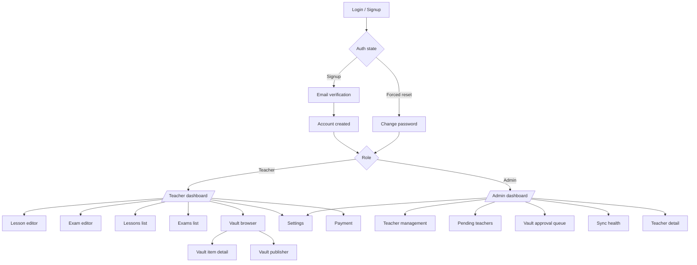
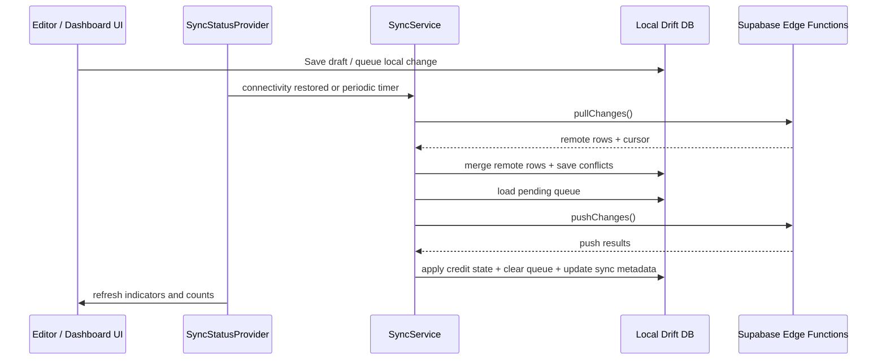

# ClassAI App Audit

**Date:** 2026-05-28  
**Scope:** Static functional + UX audit of the Flutter app, based on source inspection and targeted verification of screens, routing, services, and tests.  
**Note:** No code was changed for this audit.

## App Overview

ClassAI is a Flutter app for schools that lets admins onboard and manage teachers, verify accounts, manage subscriptions, and review sync health, while teachers can generate lesson and exam drafts with AI, preview them, unlock content with credits, edit and save locally, and sync data back to Supabase. The app also includes a vault for shared teaching resources, conflict resolution for offline edits, and a payment/settings surface for subscription and account management.

## User Roles & Journeys

## Screen Inventory

| Screen | Route | Access | Status |
|---|---|---:|---|
| Login | `/login` | Unauthenticated | Working |
| Signup | `/signup` | Unauthenticated | Working |
| Email verification | modal/dialog | Auth flow | Working |
| Teacher dashboard | `/` | Teacher | Buggy |
| Lesson editor | `/lesson-editor`, `/lessons/:id` | Teacher | Working |
| Exam editor | `/exam-editor`, `/exams/:id` | Teacher | Working |
| Lessons list | `/lessons` | Teacher | Working |
| Exams list | `/exams` | Teacher | Working |
| Vault browser | `/vault` | Teacher | Working |
| Vault publisher | `/vault/publish` | Teacher | Working |
| Vault item detail | pushed from vault browser | Teacher | Working |
| Admin dashboard | `/admin` | Admin | Buggy |
| Teacher detail | `/admin/teachers/:id` | Admin | Working |
| Settings | `/settings` | Teacher/Admin | Working |
| Payment | `/payment` | Teacher/Admin | Buggy |
| Conflict resolution | `/conflicts` | Teacher/Admin | Working |

## Data Flow Diagram

## Issues Found

| Priority | Issue | File paths | Suggested fix |
|---|---|---|---|
| Critical | Teacher routes are guarded against admins, but admin routes are not guarded against teachers. Non-admin users can still navigate to `/admin` and `/admin/teachers/:id` if they know the route. | [`lib/router/app_router.dart`](./lib/router/app_router.dart) | Add a non-admin redirect for admin paths or enforce route-level role checks. |
| Critical | The admin profile popup uses a `switch (value)` without `break`/`return` handling, so menu actions are not safely isolated and can cascade incorrectly. | [`lib/features/admin/screens/admin_dashboard_screen.dart`](./lib/features/admin/screens/admin_dashboard_screen.dart) | Replace the fallthrough switch with explicit `break`/`return` flow or a callback map. |
| High | The payment implementation is not production-safe: it uses hardcoded Monnify sandbox/test credentials and a placeholder contract code while the UI text still describes Paystack. | [`lib/core/services/payment_service.dart`](./lib/core/services/payment_service.dart), [`lib/features/payment/screens/payment_screen.dart`](./lib/features/payment/screens/payment_screen.dart) | Move credentials to env/config, align UI copy with the actual provider, and validate the live checkout flow. |
| High | SMS OTP fallback is stubbed out. Both methods throw `UnimplementedError`, so the promised SMS recovery/login path is dead. | [`lib/core/services/auth_service.dart`](./lib/core/services/auth_service.dart) | Either implement the provider integration or remove the SMS path from the product surface. |
| Medium | Concurrent-session blocking is only partially enforced from the client side. The app passes `device_id` and stores `currentDeviceId`, but there is no explicit client-side forced-logout path when a second device logs in. | [`lib/features/auth/providers/auth_provider.dart`](./lib/features/auth/providers/auth_provider.dart), [`lib/core/database/tables/teachers.dart`](./lib/core/database/tables/teachers.dart) | Make the backend return a clear revoke/replace-session signal and force the first device through logout or revalidation. |
| Medium | The dashboard has a visible edit icon on a lesson card, but its handler is empty, so the control looks interactive without doing anything. | [`lib/features/dashboard/screens/dashboard_screen.dart`](./lib/features/dashboard/screens/dashboard_screen.dart) | Route the action to the corresponding lesson editor or hide it until the action exists. |
| Low | The admin notification icon is also a visible no-op, which creates a dead-end affordance in a high-traffic screen. | [`lib/features/admin/screens/admin_dashboard_screen.dart`](./lib/features/admin/screens/admin_dashboard_screen.dart) | Wire the icon to a notifications surface or remove it until implemented. |

## Feature Completeness

| Feature | Status | Notes |
|---|---|---|
| Signup, login, email verification, forced password reset | Fully implemented | Auth state machine and dialogs are in place. |
| Teacher onboarding and pending-teacher flow | Fully implemented | Add teacher, resend password, and pending teacher states exist. |
| Lesson generation, preview, unlock, edit, save, sync | Fully implemented | Credits are deducted on unlock, not generation. |
| Exam generation, preview, unlock, edit, save, sync | Fully implemented | MCQ, theory, and subjective selection paths are present. |
| Daily preview limits | Fully implemented | 10/day for free/basic/standard; Elite is unlimited. |
| Vault browse, detail, publish, approve, acquire | Fully implemented | Core flow exists end-to-end. |
| Conflict resolution | Fully implemented | Loading, empty, and error states are present. |
| Auto sync on connectivity change and periodically | Fully implemented | Connectivity listener and periodic timer are implemented. |
| Credit deduction only on unlock | Fully implemented | Explicitly handled in both editors. |
| Admin dashboard and teacher detail management | Partially implemented | Core screens exist, but admin isolation and some actions still need work. |
| Payment checkout / activation | Partially implemented | Flow exists, but it is sandbox/hardcoded and not production-ready. |
| SMS OTP fallback | Not started | Service methods are stubbed. |
| Concurrent session blocking | Partially implemented | Server-dependent; not fully enforced in the client. |
| Dark mode and responsive layouts | Mostly implemented | Most screens are theme-aware, with a few legacy hardcoded interactions still present. |

## Summary

Total issues found: **7**

Top 3 most critical:

1. Teacher accounts can still reach admin routes because admin access is not explicitly blocked.
2. The admin profile menu switch is malformed and can mis-handle menu actions.
3. The payment stack is not production-safe because it relies on hardcoded sandbox/test credentials and mismatched provider copy.

## Verification Notes

- I inspected the router, auth state machine, dashboard/editor flows, admin screens, vault screens, payment flow, sync service, and the existing widget tests.
- `dart analyze` and the targeted widget-test runs timed out in this session, so this report is based on static source verification rather than a full live test pass.
