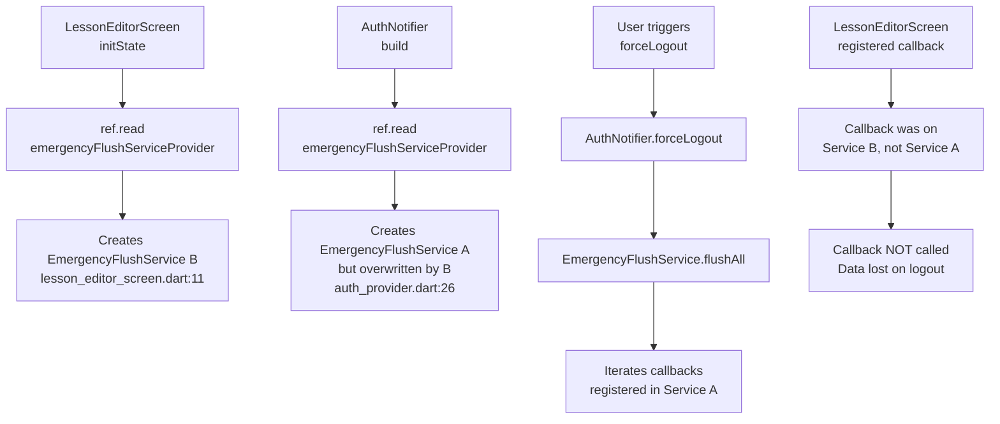
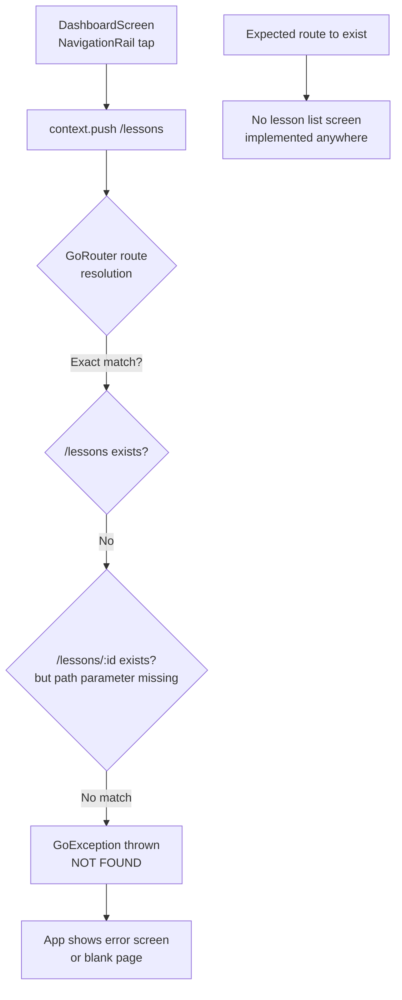
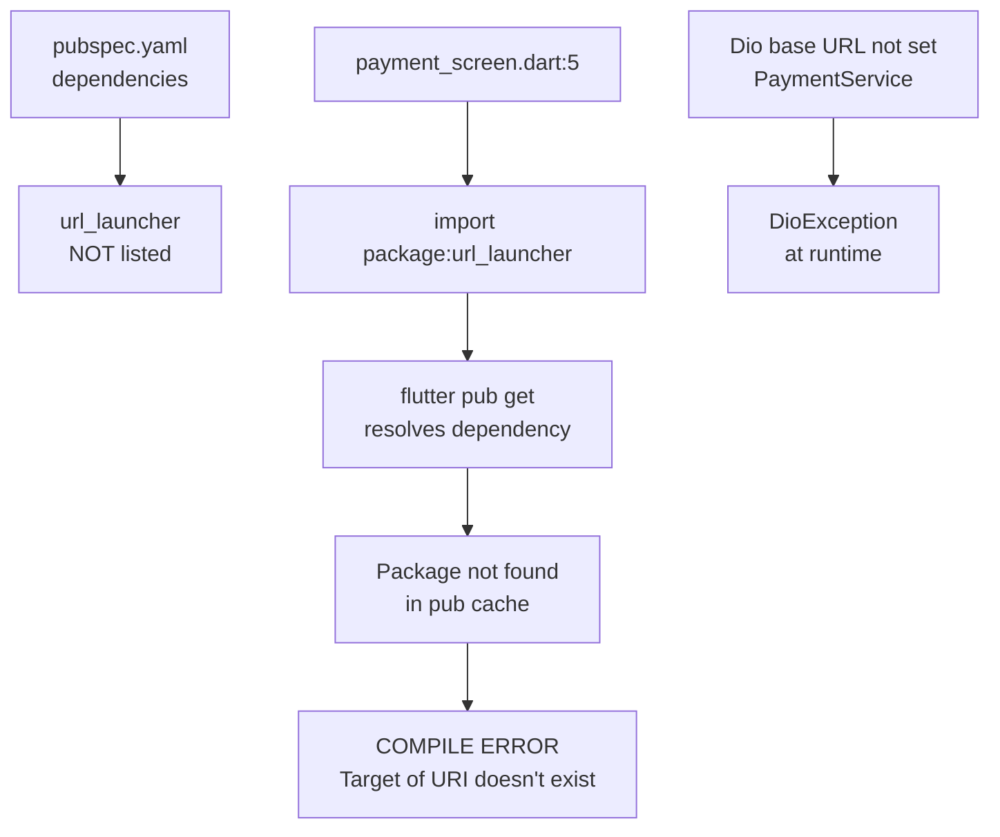
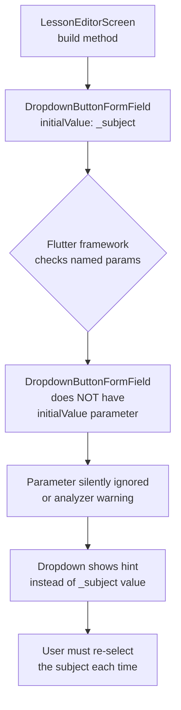
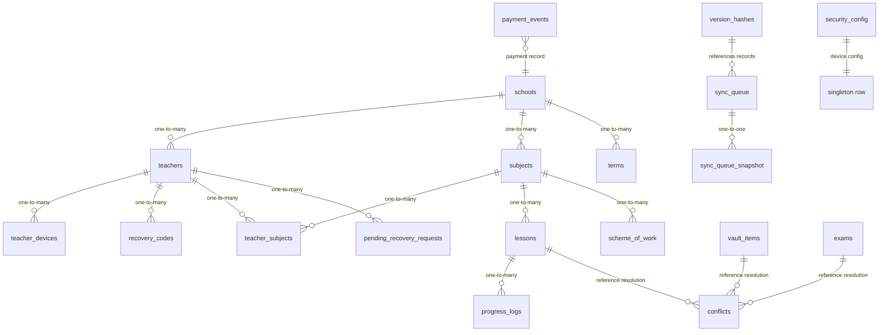

# ClassAI Static Audit Report

> **Audit date:** 2026-05-18  
> **Scope:** Full static analysis of Flutter/Dart source, Drift database schema, GoRouter configuration, Riverpod providers, Supabase Edge Functions  
> **Method:** Manual code trace — UI screen → Provider/Notifier → Service → DAO/HTTP/Edge Function  
> **Policy:** No code was modified. All issues are reported only.

---

## Table of Contents

1. [Critical Crashes](#1-critical-crashes)
2. [Logic Errors](#2-logic-errors)
3. [Missing Implementations](#3-missing-implementations)
4. [Navigation Issues](#4-navigation-issues)
5. [Performance & Edge Cases](#5-performance--edge-cases)
6. [Async Call Chain Diagrams](#6-async-call-chain-diagrams)
7. [Database Relationship Diagram](#7-database-relationship-diagram)

---

## 1. Critical Crashes

Issues that cause either a **compile-time failure** or a **guaranteed runtime crash**.

| #      | File                                                                                                                                                                                                                                | Line(s)                       | Issue                                                                                                                                                                                                                                                                                                                                                                                                                                                                                                                                   | Impact                              |
| ------ | ----------------------------------------------------------------------------------------------------------------------------------------------------------------------------------------------------------------------------------- | ----------------------------- | --------------------------------------------------------------------------------------------------------------------------------------------------------------------------------------------------------------------------------------------------------------------------------------------------------------------------------------------------------------------------------------------------------------------------------------------------------------------------------------------------------------------------------------- | ----------------------------------- |
| **C1** | `[lib/features/auth/providers/auth_provider.dart](lib/features/auth/providers/auth_provider.dart:26)` + `[lib/features/lesson/screens/lesson_editor_screen.dart](lib/features/lesson/screens/lesson_editor_screen.dart:11)`         | 26 / 11–12                    | **Duplicate `emergencyFlushServiceProvider`** — Both files define a top-level `Provider<EmergencyFlushService>` with the same name `emergencyFlushServiceProvider`. Riverpod uses global provider names; whichever is evaluated second overwrites the first, causing the `AuthNotifier` (which reads it via `ref.read`) to receive a **different singleton** than the lesson editor. When `forceLogout()` triggers `flushAll()`, the lesson editor's registered callback won't be in the flushed list → **data loss on forced logout**. | **Runtime crash / data loss**       |
| **C2** | `[lib/features/dashboard/screens/dashboard_screen.dart](lib/features/dashboard/screens/dashboard_screen.dart:155)`                                                                                                                  | 155, 159, 270, 273            | **Missing GoRoutes `/lessons` and `/exams`** — Dashboard calls `context.push('/lessons')` and `context.push('/exams')`. The router (`[app_router.dart](lib/router/app_router.dart:52-59)`) only defines `/lessons/:id` and `/exams/:id` (with path parameter). GoRouter will throw a `GoException` (route not found) when navigating to these paths.                                                                                                                                                                                    | **Runtime crash**                   |
| **C3** | `[lib/features/payment/screens/payment_screen.dart](lib/features/payment/screens/payment_screen.dart:5)`                                                                                                                            | 5                             | **Missing `url_launcher` dependency** — `import 'package:url_launcher/url_launcher.dart'` references a package that is **not listed** in `[pubspec.yaml](pubspec.yaml)`. This will cause a **compile-time error** when `flutter pub get` is run.                                                                                                                                                                                                                                                                                        | **Compile-time failure**            |
| **C4** | `[lib/main.dart](lib/main.dart:29)`                                                                                                                                                                                                 | 29                            | **Placeholder Supabase anon key** — `anonKey: '<anon-key>'` is a literal placeholder string. Supabase client initialization will succeed, but every authenticated request (sign-in, Edge Function invoke) will fail with HTTP 401 because the anon key is invalid.                                                                                                                                                                                                                                                                      | **Runtime auth failure**            |
| **C5** | `[lib/features/lesson/screens/lesson_editor_screen.dart](lib/features/lesson/screens/lesson_editor_screen.dart:286)` + `[lib/features/exam/screens/exam_editor_screen.dart](lib/features/exam/screens/exam_editor_screen.dart:266)` | 286, 300, 347 / 266, 280, 306 | `**DropdownButtonFormField.initialValue` is not a valid Flutter parameter** — Flutter's `DropdownButtonFormField` does **not** have an `initialValue` named parameter. This will either be ignored (no error, but value not initialized) or cause a type-check warning depending on Flutter version. The Flutter API uses `value` parameter for initial selection.                                                                                                                                                                      | **Runtime: dropdown appears empty** |
| **C6** | `[lib/features/exam/screens/exam_editor_screen.dart](lib/features/exam/screens/exam_editor_screen.dart:429)`                                                                                                                        | 429                           | `**RadioGroup<String>` is not a standard Flutter widget** — There is no `RadioGroup` widget in the Flutter SDK or in any imported package in `pubspec.yaml`. This will cause a **compile-time error**.                                                                                                                                                                                                                                                                                                                                  | **Compile-time failure**            |
| **C7** | `[lib/main.dart](lib/main.dart:118-125)`                                                                                                                                                                                            | 118–125                       | `**ProviderScope` created inside `FutureBuilder.builder`** — The `ProviderScope` that overrides `databaseProvider` and `authServiceProvider` is created inside the `FutureBuilder` callback. If the `FutureBuilder` rebuilds (e.g., due to a parent `setState`), a **new `ProviderScope` is created**, destroying all Riverpod state. This would reset authentication, sync state, and all editor forms.                                                                                                                                | **Runtime state reset / crash**     |
| **C8** | `[lib/features/auth/screens/sms_otp_screen.dart](lib/features/auth/screens/sms_otp_screen.dart:150)`                                                                                                                                | 148–150                       | **SMS OTP verification is stubbed** — `_verifyOtp()` calls `widget.onVerified(phoneNumber)` directly without verifying the OTP against the server. The code comment reads: *"In production, verify against the server or stored OTP"*. This means any 6-digit code is accepted.                                                                                                                                                                                                                                                         | **Security bypass**                 |

---

## 2. Logic Errors

Issues where the code compiles and runs but produces incorrect behavior.

| #      | File                                                                                                                   | Line(s)        | Issue                                                                                                                                                                                                                                                                                                                                                                                                                                                                                                                                                                      | Impact                                 |
| ------ | ---------------------------------------------------------------------------------------------------------------------- | -------------- | -------------------------------------------------------------------------------------------------------------------------------------------------------------------------------------------------------------------------------------------------------------------------------------------------------------------------------------------------------------------------------------------------------------------------------------------------------------------------------------------------------------------------------------------------------------------------- | -------------------------------------- |
| **L1** | `[lib/features/auth/screens/activation_screen.dart](lib/features/auth/screens/activation_screen.dart:111)`             | 111            | **Activation success only pops navigator** — After successful account activation, `Navigator.of(context).pop()` is called. The user was pushed onto a stack from the `LoginScreen`. The `LoginScreen` is expected to detect the auth state change via Riverpod, but this only works if the `LoginScreen` uses `ref.watch(authProvider)`. The login screen in `[main.dart](lib/main.dart:276-283)` only checks `authData.state != AuthState.authenticated`, meaning the user returns to login but **the login screen doesn't auto-navigate** to dashboard after activation. | **UX stuck at login after activation** |
| **L2** | `[lib/core/services/export_service.dart](lib/core/services/export_service.dart:25-28)`                                 | 25–28          | **CSV export uses `lesson.topic` for both Title and Topic columns** — The CSV row writes `lesson.topic` to the Title position (col 0), and `lesson.topic` again to the Topic position (col 2). Objectives, Materials, and Assessment columns are always left as empty strings.                                                                                                                                                                                                                                                                                             | **Broken CSV export**                  |
| **L3** | `[lib/features/vault/screens/vault_item_detail_screen.dart](lib/features/vault/screens/vault_item_detail_screen.dart)` | (acquire flow) | **Vault acquire bypasses `CreditService`** — When acquiring a vault item, credits are decremented directly via `securityConfigDao.updateConfig()` instead of going through `CreditService.spendCredits()`. This means the debit is **not queued for sync** via `syncQueueDao.insertEntry()`, so server credit balance will diverge from local.                                                                                                                                                                                                                             | **Credit desync**                      |
| **L4** | `[lib/features/lesson/screens/lesson_editor_screen.dart](lib/features/lesson/screens/lesson_editor_screen.dart:44)`    | 44             | `**_creditBalance` hardcoded to 3** — The lesson editor initializes `_creditBalance = 3` instead of reading from `CreditStateProvider` or `CreditService`. This hardcoded value is never updated from the database.                                                                                                                                                                                                                                                                                                                                                        | **Wrong credit display**               |
| **L5** | `[lib/core/payment/payment_service.dart](lib/core/payment/payment_service.dart:22)`                                    | 22             | **Paystack API endpoint hardcoded** — `_dio.post('/payment/initialize')` uses a relative path without a base URL configuration. `PaymentService` doesn't set a `BaseOptions.baseUrl`, so this will throw a `DioException` (bad base URL) at runtime.                                                                                                                                                                                                                                                                                                                       | **Payment flow crash**                 |
| **L6** | `[lib/core/services/credit_service.dart](lib/core/services/credit_service.dart:39)`                                    | 39             | **Credit spend sync entry has `recordLocalId: 0`** — All credit spend sync queue entries use a synthetic `recordLocalId: 0`. The sync push logic in `[sync_service.dart](lib/core/services/sync_service.dart:246-249)` looks for `localId`/`local_id`/`id` in the record to match results. If any other sync entry also has `localId=0`, result matching will be ambiguous.                                                                                                                                                                                                | **Sync corruption for credit spends**  |

---

## 3. Missing Implementations

Features that are stubbed, have placeholder content, or are incomplete.

| #      | File                                                                                                                          | Line(s) | Issue                                                                                                                                                                                                                                                                                           | Impact                                   |
| ------ | ----------------------------------------------------------------------------------------------------------------------------- | ------- | ----------------------------------------------------------------------------------------------------------------------------------------------------------------------------------------------------------------------------------------------------------------------------------------------- | ---------------------------------------- |
| **M1** | `[lib/router/app_router.dart](lib/router/app_router.dart:98-101)`                                                             | 98–101  | **Settings screen is placeholder** — The `/settings` route renders a `Scaffold` with `Center(child: Text('Settings — coming soon'))`. No actual settings UI.                                                                                                                                    | **Missing feature**                      |
| **M2** | (no file)                                                                                                                     | —       | **No lesson list or exam list screens** — Dashboard navigates to `/lessons` and `/exams` expecting list views, but these routes don't exist in GoRouter. Only `/lessons/:id` and `/exams/:id` (detail/editor routes) are defined.                                                               | **No way to see list of lessons/exams**  |
| **M3** | `[lib/core/services/ussd_recovery_service.dart](lib/core/services/ussd_recovery_service.dart:24-28)`                          | 24–28   | **USSDRecoveryService is concept-only** — The file explicitly states: *"This is a concept implementation only. Full USSD integration requires a telco agreement and gateway setup."* The `handleUssdRequest()` method returns hardcoded menu responses without any database or API interaction. | **USSD flow is non-functional**          |
| **M4** | `[lib/features/auth/providers/auth_provider.dart](lib/features/auth/providers/auth_provider.dart:16-20)`                      | 16–20   | `**authServiceProvider` throws `UnimplementedError`** — Must be overridden in `main()`. If any code path accesses this provider before the override is applied, a runtime crash occurs.                                                                                                         | **Runtime crash if access is premature** |
| **M5** | `[lib/main.dart](lib/main.dart:18-22)`                                                                                        | 18–22   | `**databaseProvider` throws `UnimplementedError`** — Same pattern as M4. Must be overridden in `main()` before any widget tree access.                                                                                                                                                          | **Runtime crash if access is premature** |
| **M6** | `[lib/core/services/sync_service.dart](lib/core/services/sync_service.dart:293-294)`                                          | 293–294 | `**sync-realtime-events` Edge Function returns hardcoded empty page** — The code comment reads: *"Placeholder Edge Function — no events yet"*. Returns `SyncRealtimePage(events: [], latestEventId: sinceEventId)` regardless of actual server state.                                           | **Realtime events are never replayed**   |
| **M7** | `[lib/core/services/emergency_flush_service.dart](lib/core/services/emergency_flush_service.dart:32)`                         | 32      | **Sentry capture is commented out** — `// Sentry.captureMessage('Emergency flush incomplete')`. `sentry_flutter` is in `pubspec.yaml` but **never initialized** in `main.dart`, so even if uncommented, it would be a no-op.                                                                    | **No crash/error monitoring**            |
| **M8** | `[lib/features/dashboard/providers/sync_status_provider.dart](lib/features/dashboard/providers/sync_status_provider.dart:61)` | 61      | **Connectivity check is simplified** — The `SyncStatusNotifier` always sets `isOnline: true` with a comment: *"Simplified; real connectivity check later"*. The app has `connectivity_plus` in dependencies but never uses it.                                                                  | **Incorrect "online" indicator**         |

---

## 4. Navigation Issues

Problems with GoRouter configuration, deep links, and screen transitions.

| #      | File                                                                                                               | Line(s)            | Issue                                                                                                                                                                                                                                                                                                                                                                                                        | Impact                      |
| ------ | ------------------------------------------------------------------------------------------------------------------ | ------------------ | ------------------------------------------------------------------------------------------------------------------------------------------------------------------------------------------------------------------------------------------------------------------------------------------------------------------------------------------------------------------------------------------------------------ | --------------------------- |
| **N1** | `[lib/features/dashboard/screens/dashboard_screen.dart](lib/features/dashboard/screens/dashboard_screen.dart:155)` | 155, 159, 270, 273 | **Dashboard pushes to `/lessons` and `/exams` (no `:id`)** — These routes don't exist in `GoRouter`. (Duplicates C2 from Critical Crashes, listed here for navigation context.)                                                                                                                                                                                                                              | **Runtime crash**           |
| **N2** | `[lib/main.dart](lib/main.dart:201-214)`                                                                           | 201–214            | **Deep link handler uses `Navigator.of(context).push()` inside GoRouter context** — When the app is already authenticated (GoRouter is active), the `_routeDeepLink()` method uses `Navigator.of(context).push(MaterialPageRoute(...))` for activation and admin-recovery screens. This pushes a route **outside** of GoRouter's navigation stack, breaking back-button behavior and route state management. | **Inconsistent navigation** |
| **N3** | `[lib/router/app_router.dart](lib/router/app_router.dart:140)`                                                     | 140                | `**handleDeepLink()` uses `context.push()` for activation** — Same screen (`ActivationScreen`) is pushed via GoRouter `context.push()` here, but via `Navigator.of(context).push()` in `main.dart:201`. Inconsistent navigation approach.                                                                                                                                                                    | **Inconsistent UX**         |
| **N4** | `[lib/router/app_router.dart](lib/router/app_router.dart:98-101)`                                                  | 98–101             | `**/settings` route is placeholder** — (Duplicates M1 from Missing Implementations.)                                                                                                                                                                                                                                                                                                                         | **Missing feature**         |

---

## 5. Performance & Edge Cases

Issues that may not crash the app but degrade performance, waste resources, or fail under specific conditions.

| #      | File                                                                                                             | Line(s)         | Issue                                                                                                                                                                                                                                                                                                                                                                                                               | Impact                                   |
| ------ | ---------------------------------------------------------------------------------------------------------------- | --------------- | ------------------------------------------------------------------------------------------------------------------------------------------------------------------------------------------------------------------------------------------------------------------------------------------------------------------------------------------------------------------------------------------------------------------- | ---------------------------------------- |
| **P1** | `[lib/core/services/sync_service.dart](lib/core/services/sync_service.dart:204-219)`                             | 204–219         | `**SupabaseSyncRemoteApi.pullChanges` silently swallows all errors** — The try-catch catches every exception and returns an empty `SyncPullPage`. If the `sync-pull` Edge Function doesn't exist, has a bug, or returns malformed data, **no error is propagated** to the caller. This makes debugging sync failures extremely difficult.                                                                           | **Silent sync failure**                  |
| **P2** | `[lib/core/services/low_storage_service.dart](lib/core/services/low_storage_service.dart:120-121)`               | 120–121         | **Last-resort disk space returns 0.0** — When disk space cannot be measured, `_getAvailableMb()` returns `0.0`. Since `0.0 < 100.0` (critical threshold), this **blocks PDF generation** on any platform where disk queries fail, including most mobile emulators.                                                                                                                                                  | **False positive storage block**         |
| **P3** | `[lib/main.dart](lib/main.dart:89-105)`                                                                          | 89–105          | **No retry mechanism for database initialization failure** — If `AppDatabase()` constructor or `db.initialize()` throws, the app shows an error screen with the error text but **no retry button**. The user must force-kill and reopen the app.                                                                                                                                                                    | **Poor error recovery**                  |
| **P4** | `[lib/core/services/sms_otp_service.dart](lib/core/services/sms_otp_service.dart:187)`                           | 187             | **OTP generation uses `microsecondsSinceEpoch` instead of `Random.secure()`** — `final random = DateTime.now().microsecondsSinceEpoch` is **predictable** and has **low entropy**. An attacker who knows the approximate time of OTP generation can predict the 6-digit code. Only 900,000 possible values.                                                                                                         | **Security vulnerability**               |
| **P5** | `[lib/core/services/sms_otp_service.dart](lib/core/services/sms_otp_service.dart:9)`                             | 9               | **API key stored in-memory without encryption** — `SmsProviderConfig` stores `apiKey` as a plain `String`. The `SmsOtpService` sends this key with every API call. If a memory dump is taken, the API key is exposed.                                                                                                                                                                                               | **API key exposure**                     |
| **P6** | `[lib/core/utils/sanitization_utils.dart](lib/core/utils/sanitization_utils.dart:18-19)`                         | 18–19           | **Sanitization strips all non-ASCII characters** — `sanitize()` removes characters outside `\x20-\x7E` (basic ASCII) and `\u00C0-\u00FF` (Latin-1 Supplement). This means **Nigerian local language characters** (e.g., Yoruba `ẹ`, `ọ`, `ṣ` with dot-below, or Igbo vowels with macrons) are **silently stripped** from prompts before AI generation.                                                              | **Data loss for local language content** |
| **P7** | `[lib/features/auth/screens/forgot_password_dialog.dart](lib/features/auth/screens/forgot_password_dialog.dart)` | (rate limiting) | **Teacher recovery rate limit uses raw SQL** — The `teacher_recovery_dialog.dart` queries `pending_recovery_requests` table with hand-written SQL (`SELECT COUNT(*) as cnt FROM pending_recovery_requests WHERE email = ? AND attempted_at > ?`). This bypasses Drift's type-safe query builder. If the table schema differs from expected (migration version mismatch), a `SqliteException` will crash the dialog. | **Runtime crash in recovery flow**       |
| **P8** | `[lib/features/dashboard/screens/dashboard_screen.dart](lib/features/dashboard/screens/dashboard_screen.dart)`   | (layout)        | **No platform gate for Editor/Reader layout** — The dashboard uses screen width to choose between `EditorLayout` and `ReaderLayout`. However, there's no explicit check for `Platform.isAndroid                                                                                                                                                                                                                     |                                          |

---

## 6. Async Call Chain Diagrams

### C1 — Duplicate `emergencyFlushServiceProvider` Crash

### C2 — Missing Route `/lessons` Crash

### C3 — Missing `url_launcher` Dependency

### C5 — `DropdownButtonFormField.initialValue` Bug

---

## 7. Database Relationship Diagram

---

## Summary

| Category                         | Count  | Severity                         |
| -------------------------------- | ------ | -------------------------------- |
| Critical Crashes (C1–C8)         | **8**  | 🔴 Will crash or fail to compile |
| Logic Errors (L1–L6)             | **6**  | 🟠 Produces incorrect behavior   |
| Missing Implementations (M1–M8)  | **8**  | 🟡 Feature gap / stub            |
| Navigation Issues (N1–N4)        | **4**  | 🟡 Broken flows                  |
| Performance & Edge Cases (P1–P8) | **8**  | 🔵 Suboptimal / fragile          |
| **Total**                        | **34** |                                  |

### Top 5 issues to fix first

1. **C3** — Missing `url_launcher` dependency → **compile-time failure**, blocks all payment flows.
2. **C6** — `RadioGroup<String>` non-existent widget → **compile-time failure**, blocks exam editor.
3. **C2 / N1** — Missing routes `/lessons` and `/exams` → **runtime crash** on dashboard navigation.
4. **C1** — Duplicate `emergencyFlushServiceProvider` → **data loss** on forced logout.
5. **C4** — Placeholder `<anon-key>` → **all API calls fail** authentication.

