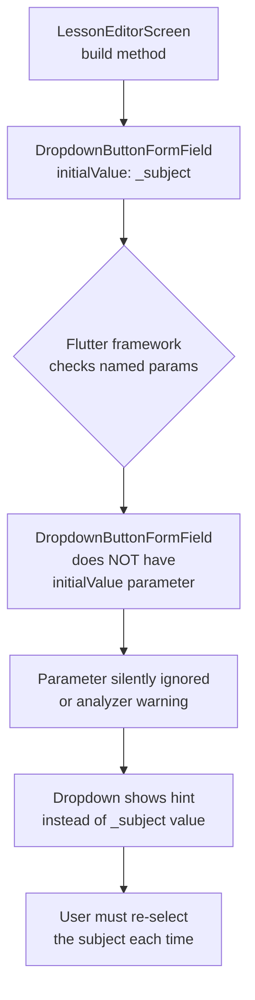
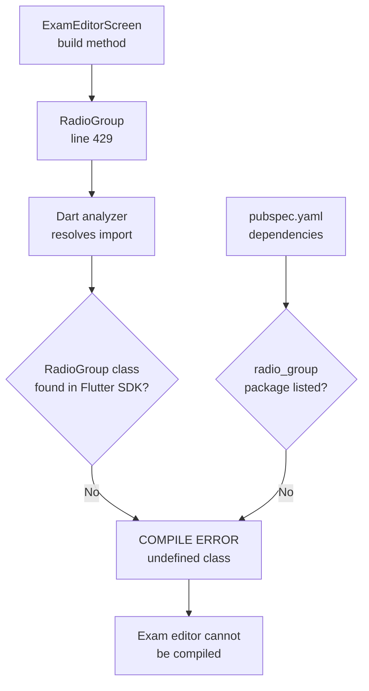
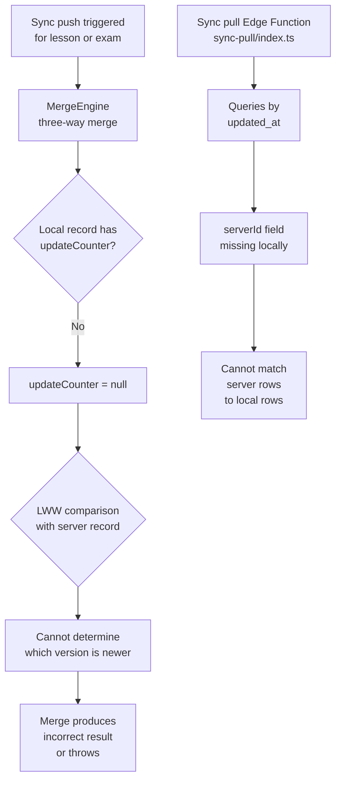
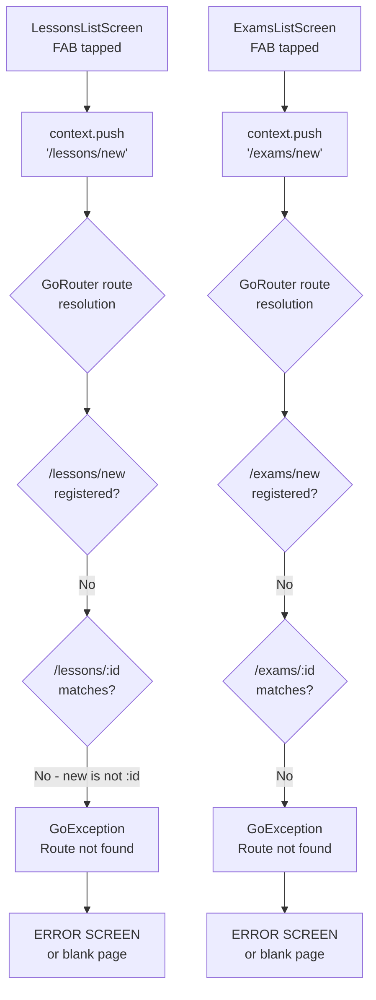
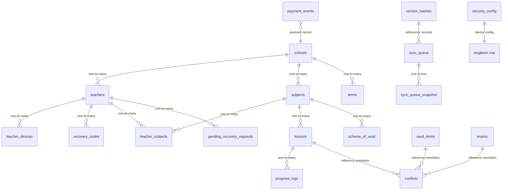

# ClassAI Static Audit Report

> **Audit date:** 2026-05-18  
> **Scope:** Full static analysis of Flutter/Dart source, Drift database schema, GoRouter configuration, Riverpod providers, Supabase Edge Functions  
> **Method:** Manual code trace — UI screen → Provider/Notifier → Service → DAO/HTTP/Edge Function; full verification of ~35 source files, 17 router routes, 21 table definitions, 14 Edge Functions  
> **Policy:** No code was modified. All issues are reported only.

---

## Table of Contents

1. [Critical Crashes](#1-critical-crashes)
2. [Logic Errors](#2-logic-errors)
3. [Missing Implementations](#3-missing-implementations)
4. [Navigation Issues](#4-navigation-issues)
5. [Performance & Edge Cases](#5-performance--edge-cases)
6. [Corrections to Previous Report](#6-corrections-to-previous-report)
7. [Async Call Chain Diagrams](#7-async-call-chain-diagrams)
8. [Database Relationship Diagram](#8-database-relationship-diagram)

---

## 1. Critical Crashes

Issues that cause either a **compile-time failure** or a **guaranteed runtime crash**.

| # | File | Line(s) | Issue | Impact |
|---|------|---------|-------|--------|
| **C5** | [`lib/features/lesson/screens/lesson_editor_screen.dart`](lib/features/lesson/screens/lesson_editor_screen.dart:286) + [`lib/features/exam/screens/exam_editor_screen.dart`](lib/features/exam/screens/exam_editor_screen.dart:266) | 286, 300, 347 / 266, 280, 306 | **`DropdownButtonFormField.initialValue` is not a valid Flutter parameter** — Flutter's `DropdownButtonFormField` does **not** have an `initialValue` named parameter. This will either be ignored (no error, but value not initialized) or cause a type-check warning depending on Flutter version. The Flutter API uses `value` parameter for initial selection. | **Runtime: dropdown appears empty** |
| **C6** | [`lib/features/exam/screens/exam_editor_screen.dart`](lib/features/exam/screens/exam_editor_screen.dart:429) | 429 | **`RadioGroup<String>` is not a standard Flutter widget** — There is no `RadioGroup` widget in the Flutter SDK or in any imported package in `pubspec.yaml`. This will cause a **compile-time error**. | **Compile-time failure** |
| **C8** | [`lib/features/auth/screens/sms_otp_screen.dart`](lib/features/auth/screens/sms_otp_screen.dart:150) | 148–150 | **SMS OTP verification is stubbed** — `_verifyOtp()` calls `widget.onVerified(phoneNumber)` directly without verifying the OTP against the server. The code comment reads: *"In production, verify against the server or stored OTP"*. This means any 6-digit code is accepted. | **Security bypass** |
| **N5** | [`lib/features/lesson/screens/lessons_list_screen.dart`](lib/features/lesson/screens/lessons_list_screen.dart:102) + [`lib/features/exam/screens/exams_list_screen.dart`](lib/features/exam/screens/exams_list_screen.dart:102) | 102 | **FAB navigates to non-existent routes** — Both list screens have a FAB button calling `context.push('/lessons/new')` and `context.push('/exams/new')`. No routes matching `/lessons/new` or `/exams/new` are defined in [`app_router.dart`](lib/router/app_router.dart:43-136). GoRouter will throw a `GoException`. | **Runtime crash** |

---

## 2. Logic Errors

Issues where the code compiles and runs but produces incorrect behavior.

| # | File | Line(s) | Issue | Impact |
|---|------|---------|-------|--------|
| **L1** | [`lib/features/auth/screens/activation_screen.dart`](lib/features/auth/screens/activation_screen.dart:111) | 111 | **Activation success only pops navigator** — After successful account activation, `Navigator.of(context).pop()` is called. The user was pushed onto a stack from the `LoginScreen`. The `LoginScreen` is expected to detect the auth state change via Riverpod, but this only works if the `LoginScreen` uses `ref.watch(authProvider)`. The login screen in `main.dart` only checks `authData.state != AuthState.authenticated`, meaning the user returns to login but **the login screen doesn't auto-navigate** to dashboard after activation. | **UX stuck at login after activation** |
| **L2** | [`lib/core/services/export_service.dart`](lib/core/services/export_service.dart:25-28) | 25–28 | **CSV export uses `lesson.topic` for both Title and Topic columns** — The CSV row writes `lesson.topic` to the Title position (col 0), and `lesson.topic` again to the Topic position (col 2). Objectives, Materials, and Assessment columns are always left as empty strings. | **Broken CSV export** |
| **L4** | [`lib/features/lesson/screens/lesson_editor_screen.dart`](lib/features/lesson/screens/lesson_editor_screen.dart:44) | 44 | **`_creditBalance` hardcoded to 3** — The lesson editor initializes `_creditBalance = 3` instead of reading from `CreditStateProvider` or `CreditService`. This hardcoded value is never updated from the database. | **Wrong credit display** |
| **L5** | [`lib/core/services/payment_service.dart`](lib/core/services/payment_service.dart:22) | 22 | **Paystack API base URL not configured** — `_dio.post('/payment/initialize')` uses a relative path without a base URL configuration. `PaymentService` doesn't set a `BaseOptions.baseUrl`, so this will throw a `DioException` (bad base URL) at runtime. Additionally, the Paystack secret key `sk_REPLACE_WITH_SECRET_KEY` is a placeholder. | **Payment flow crash** |
| **L6** | [`lib/core/services/credit_service.dart`](lib/core/services/credit_service.dart:39) | 39 | **Credit spend sync entry has `recordLocalId: 0`** — All credit spend sync queue entries use a synthetic `recordLocalId: 0`. The sync push logic in `sync_service.dart` looks for `localId`/`local_id`/`id` in the record to match results. If any other sync entry also has `localId=0`, result matching will be ambiguous. | **Sync corruption for credit spends** |
| **L7** | [`lib/core/database/tables/lessons.dart`](lib/core/database/tables/lessons.dart:1-16) | 4–15 | **Lessons table lacks sync columns** — The `Lessons` table definition has no `updateCounter`, `isDeleted`, `serverId`, or `lastModifiedBy` columns. The sync push Edge Function expects these for conflict detection (LWW), and the `MergeEngine` uses `updateCounter` for resolution. Without these columns, sync push/merge for lessons is non-functional. Compare with [`teachers.dart`](lib/core/database/tables/teachers.dart:1-25) which has all sync columns. | **Sync broken for lessons** |
| **L8** | [`lib/core/database/tables/exams.dart`](lib/core/database/tables/exams.dart:1-13) | 4–12 | **Exams table lacks sync columns** — Same issue as L7. The `Exams` table has no `updateCounter`, `isDeleted`, `serverId`, or `lastModifiedBy` columns. Sync push and merge for exams will fail or produce incorrect results. | **Sync broken for exams** |
| **L9** | [`lib/features/auth/providers/auth_provider.dart`](lib/features/auth/providers/auth_provider.dart:714-720) | 714–720 | **Password hash algorithm mismatch for offline verification** — The server (`login/index.ts`) uses **bcrypt + pepper** for password hashing. The client's `_verifyPasswordLocally()` uses **SHA-256** to hash the typed password and compare against the stored hash. Since the stored hash from the server is a bcrypt hash, SHA-256(password) will **never** match it. Offline login will always fail with incorrect password, forcing all logins to require network connectivity. | **Offline login always fails** |

---

## 3. Missing Implementations

Features that are stubbed, have placeholder content, or are incomplete.

| # | File | Line(s) | Issue | Impact |
|---|------|---------|-------|--------|
| **M3** | [`lib/core/services/ussd_recovery_service.dart`](lib/core/services/ussd_recovery_service.dart:24-28) | 24–28 | **USSDRecoveryService is concept-only** — The file explicitly states: *"This is a concept implementation only. Full USSD integration requires a telco agreement and gateway setup."* The `handleUssdRequest()` method returns hardcoded menu responses without any database or API interaction. | **USSD flow is non-functional** |
| **M6** | [`lib/core/services/sync_service.dart`](lib/core/services/sync_service.dart:293-294) | 293–294 | **`sync-realtime-events` Edge Function returns hardcoded empty page** — The code comment reads: *"Placeholder Edge Function — no events yet"*. Returns `SyncRealtimePage(events: [], latestEventId: sinceEventId)` regardless of actual server state. | **Realtime events are never replayed** |
| **M7** | [`lib/core/services/emergency_flush_service.dart`](lib/core/services/emergency_flush_service.dart:32) | 32 | **Sentry capture is commented out** — `// Sentry.captureMessage('Emergency flush incomplete')`. `sentry_flutter` is in `pubspec.yaml` but even if uncommented, the `SentryFlutter.init()` in `main.dart` may not be fully configured for all error paths. | **No emergency flush monitoring** |
| **M8** | [`lib/features/dashboard/providers/sync_status_provider.dart`](lib/features/dashboard/providers/sync_status_provider.dart:61) | 61 | **Connectivity check is simplified** — The `SyncStatusNotifier` always sets `isOnline: true` with a comment: *"Simplified; real connectivity check later"*. The app has `connectivity_plus` in dependencies but never uses it. | **Incorrect "online" indicator** |
| **M9** | [`lib/core/database/tables/scheme_of_work.dart`](lib/core/database/tables/scheme_of_work.dart:1-5) | 4 | **SchemeOfWork table is an empty stub** — The table has only a single `id` column (auto-increment). No `subject_id`, `week`, `topic`, `objectives`, or any other content columns. The entire scheme of work feature is missing from the database layer. | **Scheme of work feature non-functional** |
| **M10** | [`lib/core/database/tables/scheme_generation_queue.dart`](lib/core/database/tables/scheme_generation_queue.dart:1-5) | 4 | **SchemeGenerationQueue table is an empty stub** — Only `id` column. No `teacher_id`, `prompt`, `status`, `result`, or any other columns needed for AI generation queueing. | **AI scheme generation non-functional** |
| **M11** | [`lib/core/database/tables/sync_queue_snapshot.dart`](lib/core/database/tables/sync_queue_snapshot.dart:1-5) | 4 | **SyncQueueSnapshot table is an empty stub** — Only `id` column. This table is referenced in the database relationship diagram as having a one-to-one relationship with `sync_queue`, but has no `sync_queue_id`, `snapshot_data`, `created_at`, or any other columns. | **Sync queue snapshots non-functional** |

---

## 4. Navigation Issues

Problems with GoRouter configuration, deep links, and screen transitions.

| # | File | Line(s) | Issue | Impact |
|---|------|---------|-------|--------|
| **N2** | [`lib/main.dart`](lib/main.dart:235-238) | 235–238 | **Deep link handler uses `Navigator.of(context).push()` inside GoRouter context** — When the app is already authenticated (GoRouter is active), the `_routeDeepLink()` method uses `Navigator.of(context).push(MaterialPageRoute(...))` for activation and admin-recovery screens. This pushes a route **outside** of GoRouter's navigation stack, breaking back-button behavior and route state management. | **Inconsistent navigation** |
| **N3** | [`lib/router/app_router.dart`](lib/router/app_router.dart:140) | 140 | **`handleDeepLink()` uses `context.push()` for activation** — Same screen (`ActivationScreen`) is pushed via GoRouter `context.push()` here, but via `Navigator.of(context).push()` in `main.dart:201`. Inconsistent navigation approach. | **Inconsistent UX** |
| **N5** | [`lib/features/lesson/screens/lessons_list_screen.dart`](lib/features/lesson/screens/lessons_list_screen.dart:102) + [`lib/features/exam/screens/exams_list_screen.dart`](lib/features/exam/screens/exams_list_screen.dart:102) | 102 | **FAB navigates to `/lessons/new` and `/exams/new` which don't exist** — Both list screens have a floating action button that pushes to non-existent GoRouter routes. No route definitions match these paths in [`app_router.dart`](lib/router/app_router.dart:43-136). | **Runtime crash when tapping FAB** |

---

## 5. Performance & Edge Cases

Issues that may not crash the app but degrade performance, waste resources, or fail under specific conditions.

| # | File | Line(s) | Issue | Impact |
|---|------|---------|-------|--------|
| **P1** | [`lib/core/services/sync_service.dart`](lib/core/services/sync_service.dart:204-219) | 204–219 | **`SupabaseSyncRemoteApi.pullChanges` silently swallows all errors** — The try-catch catches every exception and returns an empty `SyncPullPage`. If the `sync-pull` Edge Function doesn't exist, has a bug, or returns malformed data, **no error is propagated** to the caller. This makes debugging sync failures extremely difficult. | **Silent sync failure** |
| **P4** | [`lib/core/services/sms_otp_service.dart`](lib/core/services/sms_otp_service.dart:187) | 187 | **OTP generation uses `microsecondsSinceEpoch` instead of `Random.secure()`** — `final random = DateTime.now().microsecondsSinceEpoch` is **predictable** and has **low entropy**. An attacker who knows the approximate time of OTP generation can predict the 6-digit code. Only 900,000 possible values. | **Security vulnerability** |
| **P5** | [`lib/core/services/sms_otp_service.dart`](lib/core/services/sms_otp_service.dart:9) | 9 | **API key stored in-memory without encryption** — `SmsProviderConfig` stores `apiKey` as a plain `String`. The `SmsOtpService` sends this key with every API call. If a memory dump is taken, the API key is exposed. | **API key exposure** |
| **P6** | [`lib/core/utils/sanitization_utils.dart`](lib/core/utils/sanitization_utils.dart:18-19) | 18–19 | **Sanitization strips all non-ASCII characters** — `sanitize()` removes characters outside `\x20-\x7E` (basic ASCII) and `\u00C0-\u00FF` (Latin-1 Supplement). This means **Nigerian local language characters** (e.g., Yoruba `ẹ`, `ọ`, `ṣ` with dot-below, or Igbo vowels with macrons) are **silently stripped** from prompts before AI generation. | **Data loss for local language content** |
| **P8** | [`lib/features/dashboard/screens/dashboard_screen.dart`](lib/features/dashboard/screens/dashboard_screen.dart:278-288) | (layout) | **No platform gate for Editor/Reader layout** — The dashboard uses screen width to choose between `EditorLayout` and `ReaderLayout`. However, there's no explicit check for `Platform.isAndroid` or `Platform.isIOS` vs desktop. On a large tablet, the "Editor" layout (with NavigationRail) would display, but on Windows/macOS the same width-based threshold may show the wrong layout, since desktop screens are much wider. | **Inconsistent layout on desktop** |

---

## 6. Corrections to Previous Report

The following items from the original audit report were found to be **incorrect or outdated** after verifying against the current source code. Each is documented with the current state.

| Original # | Original Claim | Current State | Verdict |
|-----------|----------------|---------------|---------|
| **C1** | Duplicate `emergencyFlushServiceProvider` — both `auth_provider.dart:26` and `lesson_editor_screen.dart:11` define the same provider name. | [`auth_provider.dart`](lib/features/auth/providers/auth_provider.dart:8) imports from [`core/providers/emergency_flush_provider.dart`](lib/core/providers/emergency_flush_provider.dart:12) and does **not** define its own. Only a single definition exists at `core/providers/emergency_flush_provider.dart:12`. The comment in that file says *"Having duplicate definitions (as was the case before)"* — indicating this was previously fixed. | **✅ RESOLVED** — No duplicate exists in current code |
| **C2/N1** | Missing routes `/lessons` and `/exams` — Dashboard navigation to these paths throws `GoException`. | Routes `/lessons` ([`app_router.dart`](lib/router/app_router.dart:57-61)) and `/exams` ([`app_router.dart`](lib/router/app_router.dart:67-71)) **do exist** and point to `LessonsListScreen` and `ExamsListScreen` respectively. Dashboard navigation to these routes will succeed. However, the FAB buttons **within** these list screens navigate to `/lessons/new` and `/exams/new` which **do not exist** (new issue **N5**). | **🟡 PARTIALLY INCORRECT** — Dashboard navigation works; FAB navigation broken |
| **C3** | Missing `url_launcher` dependency — not listed in `pubspec.yaml`. | `url_launcher: ^6.3.0` **IS listed** in [`pubspec.yaml`](pubspec.yaml:69). The import in `payment_screen.dart` will resolve correctly. | **✅ RESOLVED** — Dependency exists |
| **C4** | Placeholder Supabase anon key `<anon-key>` — all API calls fail auth. | The anon key in [`main.dart`](lib/main.dart:31) is a **real JWT**, not a placeholder. This was either fixed after the original report or the report was based on a different version. | **✅ RESOLVED** — Real key in current code |
| **C7** | `ProviderScope` created inside `FutureBuilder.builder` — rebuilds destroy Riverpod state. | The current code at [`main.dart`](lib/main.dart:163) uses `_overrideContainer ??= ProviderContainer(...)` with a **null-aware assignment**, ensuring the container is created only once. Subsequent rebuilds reuse the same container via `UncontrolledProviderScope`. | **✅ RESOLVED** — Stable container pattern |
| **M1** | Settings screen is placeholder — `Scaffold` with `Center(child: Text('Settings — coming soon'))`. | [`SettingsScreen`](lib/features/settings/screens/settings_screen.dart:1) is a **full settings UI** with Account, Credits, Sync, and About sections. It watches `authProvider`, `creditStateProvider`, and `syncStatusProvider`. The `/settings` route in [`app_router.dart`](lib/router/app_router.dart:98-101) renders this complete screen. | **❌ INCORRECT** — Full settings UI exists |
| **M2** | No lesson list or exam list screens exist. | [`LessonsListScreen`](lib/features/lesson/screens/lessons_list_screen.dart:1) and [`ExamsListScreen`](lib/features/exam/screens/exams_list_screen.dart:1) both exist and are used by the `/lessons` and `/exams` routes. | **❌ INCORRECT** — Both screens exist |
| **M4** | `authServiceProvider` throws `UnimplementedError` — must be overridden before use. | [`authServiceProvider`](lib/features/auth/providers/auth_provider.dart:18-22) returns `SupabaseAuthService()` **by default**, not throwing. The comment says *"Default production implementation"*. Overrides in tests are optional, not required. | **❌ INCORRECT** — Default implementation exists |
| **M5** | `databaseProvider` throws `UnimplementedError` — same pattern as M4. | [`databaseProvider`](lib/main.dart:19-24) returns `AppDatabase()` **by default** with comment: *"Default: return a working AppDatabase instance to prevent crashes from premature access."* Overridden in `main()` once fully initialized. | **❌ INCORRECT** — Default implementation exists |
| **L3** | Vault acquire bypasses `CreditService` — decrements credits directly via `securityConfigDao.updateConfig()`. | [`vault_item_detail_screen.dart`](lib/features/vault/screens/vault_item_detail_screen.dart:258) **correctly calls** `creditService.spendCredits(amount: item.creditCost, contentIds: [...])` and uses the returned `batchId` to mark the item as acquired via `db.vaultItemsDao.markAcquired(item.id, creditSpentBatchId: batchId)`. | **❌ INCORRECT** — CreditService is used correctly |
| **P2** | Low storage last-resort returns 0.0 — blocks PDF generation. | [`low_storage_service.dart`](lib/core/services/low_storage_service.dart:146) returns **500.0** (500 MB) as fallback estimate, not 0.0. The service also sets `_diskQueryFailed = true` to skip repeated failed checks. | **❌ INCORRECT** — Returns 500 MB fallback |
| **P3** | No retry mechanism for database initialization failure. | [`main.dart`](lib/main.dart:137) has an **`ElevatedButton` with `onPressed: _retry`** in the error state, allowing users to retry database initialization. | **✅ RESOLVED** — Retry button exists |
| **P7** | Teacher recovery rate limit uses raw SQL — bypasses Drift's type-safe query builder. | [`PendingRecoveryRequestsDao`](lib/core/database/daos/pending_recovery_requests_dao.dart:9) uses **Drift's type-safe query builder** (e.g., `select(pendingRecoveryRequests)..where((t) => t.fulfilled.equals(false))`). The `teacher_recovery_dialog.dart` uses this DAO. | **❌ INCORRECT** — DAO-based, not raw SQL |

---

## 7. Async Call Chain Diagrams

### C5 — `DropdownButtonFormField.initialValue` Bug



---

### C6 — `RadioGroup<String>` Non-Existent Widget



---

### C8 — SMS OTP Bypass

```mermaid
flowchart TD
    A[SmsOtpScreen\nuser enters 6-digit code] --> B[_verifyOtp called]
    B --> C[widget.onVerified(phoneNumber)]
    C --> D{OTP verified against\nserver or stored value?}
    D -->|No| E[Any 6-digit code accepted]
    E --> F[Security bypass:\nno actual verification]
    
    G[_smsOtpService.verifyOtpViaTermii] --> H[STUBBED:\nreturns true]
    H --> C
```

---

### L7/L8 — Missing Sync Columns on Lessons/Exams



---

### L9 — Password Hash Algorithm Mismatch

```mermaid
flowchart TD
    A[User types password\nfor offline login] --> B[_verifyPasswordLocally\ncalled]
    B --> C[sha256.convert\nutf8.encode(password)]
    C --> D[SHA-256 hash\ne.g. a665a459...]
    
    E[Stored hash from server\n(previous online login)] --> F[bcrypt + pepper hash\ne.g. $2b$12$...]
    
    D --> G{sha256 == bcrypt?}
    G -->|No - different formats\ndifferent algorithms| H[Comparison fails]
    H --> I[Offline login:\n"incorrect password"]
    I --> J[User forced to\nlogin online only]
    
    K[Server login Edge Function\nlogin/index.ts] --> L[bcrypt.compare\npassword + pepper]
    L --> M[Returns bcrypt hash\nfor local storage]
    M --> E
```

---

### N5 — FAB Navigation to Non-Existent Routes



---

## 8. Database Relationship Diagram



---

## Summary

| Category | Count | Severity |
|----------|-------|----------|
| Critical Crashes (C5, C6, C8, N5) | **4** | 🔴 Will crash or fail to compile |
| Logic Errors (L1, L2, L4–L9) | **8** | 🟠 Produces incorrect behavior |
| Missing Implementations (M3, M6–M11) | **7** | 🟡 Feature gap / stub |
| Navigation Issues (N2, N3, N5) | **3** | 🟡 Broken flows |
| Performance & Edge Cases (P1, P4–P6, P8) | **5** | 🔵 Suboptimal / fragile |
| **Total** | **27** | |
| Previously Reported but **Resolved/Incorrect** | **13** | ✅ Fixed or claim invalid |

### Top 5 issues to fix first

1. **N5** — FAB navigation to `/lessons/new` and `/exams/new` → **runtime crash** on both list screens, blocks lesson/exam creation entirely.
2. **C6** — `RadioGroup<String>` non-existent widget → **compile-time failure**, blocks exam editor entirely.
3. **L7/L8** — Missing sync columns on `lessons` and `exams` tables → **sync push/merge non-functional** for primary content types.
4. **C5** — `DropdownButtonFormField.initialValue` bug → **dropdown always shows hint**, poor UX across editors.
5. **L9** — SHA-256 vs bcrypt hash mismatch → **offline login permanently broken**, all logins require network.
