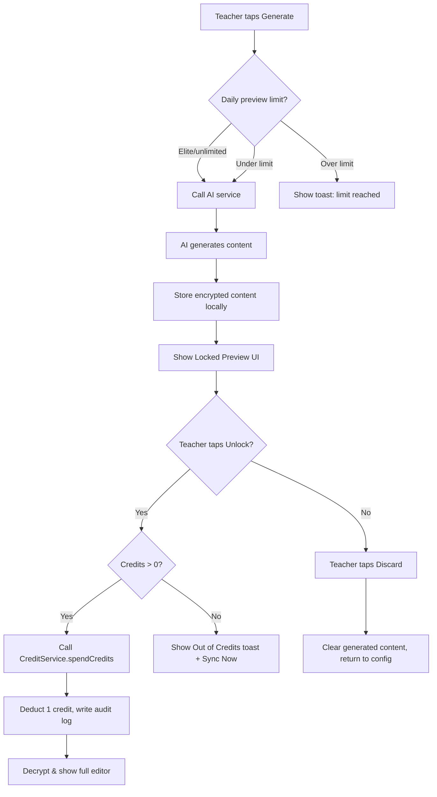

# Credit & Preview/Unlock System Implementation Plan

## Overview

This plan covers the full credit-based preview/unlock system for ClassAI. The core mechanic: AI generation produces a **locked preview** (free, limited to 10/day for non-Elite). Teachers spend **1 offline credit** to unlock the full editable content. Credits reset to 3 after each successful sync.

## Architecture Diagram



## Files to Modify

| # | File | Change |
|---|------|--------|
| 1 | `lib/core/database/tables/security_config.dart` | Add `dailyPreviewCount` and `dailyPreviewDate` columns |
| 2 | `lib/core/database/tables/lessons.dart` | Add `isUnlocked` column |
| 3 | `lib/core/database/tables/exams.dart` | Add `isUnlocked` column |
| 4 | `lib/core/database/daos/security_config_dao.dart` | Add `checkAndIncrementDailyPreviews()`, update `updateConfig()` for new fields |
| 5 | `lib/features/lesson/screens/lesson_editor_screen.dart` | Full locked preview + unlock flow + daily preview limit + update prompt attribution |
| 6 | `lib/features/exam/screens/exam_editor_screen.dart` | Same as lesson editor |
| 7 | `lib/core/constants/prompt_templates.dart` | Insert attribution every 2-3 paragraphs (not just at end) |
| 8 | `lib/core/services/pdf_service.dart` | Add teacher email to watermark |
| 9 | Run `dart run build_runner build` | Regenerate drift files after schema changes |

## Detailed Step-by-Step

### Step 1: Database Schema Changes

#### File: `lib/core/database/tables/security_config.dart`
Add after `dailyPdfExportDate` (line 52):
```dart
IntColumn get dailyPreviewCount => integer().withDefault(const Constant(0))();
TextColumn get dailyPreviewDate => text().nullable()();
```

#### File: `lib/core/database/tables/lessons.dart`
Add after `schoolServerId` (line 21):
```dart
BoolColumn get isUnlocked => boolean().withDefault(const Constant(false))();
```

#### File: `lib/core/database/tables/exams.dart`
Add after `schoolServerId` (line 18):
```dart
BoolColumn get isUnlocked => boolean().withDefault(const Constant(false))();
```

### Step 2: SecurityConfigDao Changes

#### File: `lib/core/database/daos/security_config_dao.dart`

**A. Update `updateConfig()`** — Add parameters for:
- `int? dailyPreviewCount`
- `String? dailyPreviewDate`

**B. Add `checkAndIncrementDailyPreviews()` method** — Pattern identical to `checkAndIncrementDailyGenerations()` but uses the new `dailyPreviewCount`/`dailyPreviewDate` fields. Limits: free=10, basic=10, standard=10, elite=-1.

### Step 3: Regenerate Drift Files
Run: `dart run build_runner build` (after schema changes).

### Step 4: Prompt Template Changes

#### File: `lib/core/constants/prompt_templates.dart`
The spec requires attribution every 2-3 paragraphs. The current templates add attribution once at the end. Since the AI generates the content, we can't easily insert post-generation. Instead, modify the prompt instruction to say:
> "Include the following attribution line every 2-3 paragraphs throughout the content, not just at the end: '— Generated for [Teacher Name], [School Name]. Not for redistribution.'"

The `teacherName` and `schoolName` parameters are already present in all template methods — the editors just need to pass them.

### Step 5: Lesson Editor — Full Rewrite of Generation/Unlock Flow

#### File: `lib/features/lesson/screens/lesson_editor_screen.dart`

**A. `_handleGenerate()` changes:**
1. **Remove** the credit check (`if (_creditBalance < 1)`) — preview generation is FREE.
2. **Remove** the "Insufficient credits" toast.
3. **Before** calling AI generation, call a new daily preview limit check:
   - If non-Elite tier: call `await db.securityConfigDao.checkAndIncrementDailyPreviews(tier: _subscriptionTier)`
   - If returns false: show toast "Daily preview limit reached. Try again tomorrow." and return.
   - If Elite: skip check.
4. **Pass teacher name and school name** to `PromptTemplates.lessonNote()`:
   ```dart
   final teacherName = authData.currentTeacher?.teacherName ?? 'Teacher';
   final schoolName = authData.currentSchool?.schoolName ?? 'School';
   final prompt = PromptTemplates.lessonNote(..., teacherName: teacherName, schoolName: schoolName);
   ```
5. Remove "Estimated Cost: 20 Credits" text from the config column (`_ConfigColumn` widget, line 1188-1194).

**B. `_handleUnlock()` changes:**
- The current implementation already works well — it calls `CreditService.spendCredits(amount: 1, ...)`, then sets `_isUnlocked = true`.
- After unlock success, also **update the database record** if it's been saved: set `isUnlocked = true` on the lesson record for persistence.
- Refresh the credit counter via `creditStateProvider.notifier.refresh()`.

**C. Locked Preview UI Changes** (in `_PreviewColumn`):
1. **Background color**: Change from `cs.tertiary` (blue) to amber/yellow. Use a dedicated amber color or `Colors.amber.shade50` for the background container.
2. **Content excerpt**: Show objectives + first 2 paragraphs of presentation text as read-only, **non-selectable** `Text` widget (currently uses `_renderMarkdownContent` which renders `Text`, but ensure no `SelectableText` is used).
3. **Green banner when unlocked**: Add a green banner at the top when `isUnlocked` is true showing "Unlocked" with a check icon.

**D. Save flow:**
- Save button (`_saveLesson`) should only be enabled/active when `_isUnlocked` is true.
- When saving, also store `isUnlocked: true` in the lesson record.

**E. Loading existing lesson:**
- In `_loadLesson()`, if the loaded lesson has `isUnlocked == true`, set `_isUnlocked = true` and decrypt content.

### Step 6: Exam Editor — Same Pattern

#### File: `lib/features/exam/screens/exam_editor_screen.dart`

**A. `_handleGenerate()` changes:**
1. Remove credit check before generation.
2. Add daily preview limit check (same as lesson editor).
3. Remove "Generate Exam (-50 Credits)" text — change to "Generate Exam".
4. Pass teacher name and school name to prompt templates.

**B. `_handleUnlock()` changes:**
- Same pattern as lesson editor.

**C. Preview panel changes:**
- Same amber/yellow locked preview, green unlocked banner.
- Non-selectable excerpt text in locked state.

**D. Save flow:**
- Only allow save when `_isUnlocked` is true.

### Step 7: PDF Watermark Enhancement

#### File: `lib/core/services/pdf_service.dart`

Currently the watermark shows: `'Generated by ClassAI — ${params.schoolName}'`

Change to include teacher email. The `generateLessonPdf()` method already receives `teacherId`. We need to:
1. Load the teacher record from DB to get their email.
2. Pass the teacher email to `_PdfParams`.
3. Update the watermark text to: `'Generated by ClassAI — ${params.schoolName} | ${params.teacherEmail}'`

Also verify: the `generateExamPdf()` or similar method exists or use the same `generateLessonPdf` pattern.

### Step 8: UI Cleanup

1. **Credit counter update**: After unlock, call `ref.read(creditStateProvider.notifier).refresh()` to update the AppBar counter immediately.
2. **Remove old credit cost labels**: 
   - Lesson editor: Remove "Estimated Cost: 20 Credits" 
   - Exam editor: Change "Generate Exam (-50 Credits)" to "Generate Exam"
3. **Ensure Discard button clears `_hasGenerated` and returns to config view**: Current `_discard()` already does this.

### Step 9: Tests

#### Update `test/features/lesson_editor_test.dart`
- Tests that call generate callback need to account for the locked preview UI instead of full editor.
- The "save button persists to database" test needs to first unlock before saving.
- Add new test: "generate with 0 credits succeeds (preview is free)".
- Add new test: "unlock deducts credit and shows full editor".

#### Update `test/credits/credit_service_test.dart`
- Existing tests should still pass (no schema changes to credit fields).

#### Run `dart analyze` and fix issues
- After all changes, run `dart analyze` and fix any analysis issues.

### Step 10: Verification Checklist

| Check | Expected Result |
|-------|----------------|
| Generate lesson with credits=0 | Locked preview shown (no credit check) |
| Generate 11 lessons in a day (non-Elite) | 11th shows "Daily preview limit reached" |
| Elite tier | No daily preview limit |
| Tap Unlock with credits > 0 | Credit deducted, full editor shown, credit counter updates |
| Tap Unlock with credits = 0 | Toast "Out of credits" + Sync Now button |
| Navigate away and back | Previously unlocked lesson/exam shows full editor |
| Save only works when unlocked | Save button disabled/ignored when locked |
| Discard clears content | Returns to config view |
| PDF watermark | Includes school name AND teacher email |
| $dart analyze$ | No errors |
| $flutter test$ | All tests pass |
