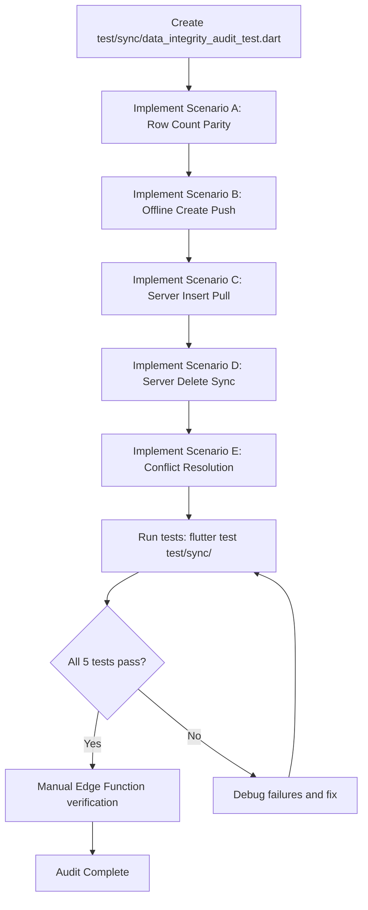

# ClassAI Data Integrity Audit Plan

**Date:** 2026-07-12  
**Author:** Architectural Review  
**Scope:** End-to-end data integrity verification for the sync pipeline  
**Goal:** Ensure Drift (local) ↔ Supabase (remote) data remains consistent across all sync operations

---

## 1. Audit Test Scenarios

The audit covers **5 core scenarios** that exercise the complete push-pull-merge lifecycle:

### Scenario A — Full Sync Row Count Parity
**Goal:** After a complete sync cycle, all critical tables have identical row counts locally and remotely.

**Procedure:**
1. Seed known row counts in both Drift and Supabase for each `_syncableTables` table
2. Execute `SyncService.onConnectivityRestored()` via the `FakeSyncRemoteApi` harness
3. Assert row counts match for: `subjects`, `lessons`, `exams`, `progress_logs`, `vault_items`, `scheme_of_work`, `teachers`, `schools`

**Files to create/modify:**
- `test/sync/data_integrity_audit_test.dart` (new test file)

### Scenario B — Offline Create → Reconnect → Server Preserved
**Goal:** A lesson created offline must appear on Supabase after connectivity is restored.

**Procedure:**
1. Create a lesson in Drift with no sync queue entry yet
2. Insert a `syncQueueDao.insertEntry()` for the lesson with `INSERT` operation
3. Use `FakeSyncRemoteApi` that captures the push payload
4. Call `SyncService.onConnectivityRestored()`
5. Assert: `SyncPushBatch` with table `'lessons'` was sent
6. Assert: All critical fields (`title`, `content`, `subject`, `classLevel`, `topic`, `difficulty`, `bloomsVerbs`, `curriculum`, `teacher_server_id`, `school_server_id`, `week_number`, `term`, `status`, `content_hash`, `is_unlocked`) are in the pushed payload

### Scenario C — Server Insert → Pull → Local Preserved
**Goal:** An exam created on Supabase must appear in Drift after a pull.

**Procedure:**
1. Seed a `SyncPullPage` with a new `'exams'` change (simulating creation on Supabase Dashboard)
2. Call `SyncService.onConnectivityRestored()`
3. Assert the exam record was upserted into the local `exams` Drift table
4. Assert all critical fields match the remote payload

**Files:**
- `test/sync/data_integrity_audit_test.dart`

### Scenario D — Server Delete → Sync → Local Delete
**Goal:** A lesson deleted online must be deleted locally after sync.

**Procedure:**
1. Seed a local lesson record in Drift
2. Provide a `SyncPullPage` with the same lesson flagged as `is_deleted: true`
3. Call `SyncService.onConnectivityRestored()`
4. Assert the lesson record is soft-deleted (or removed) from the local Drift table

### Scenario E — Conflict Resolution (Same Record, Both Sides)
**Goal:** When the same field is modified both locally and remotely, sync must:
- Detect the conflict
- Save the conflict to the `conflicts` table
- Not lose data from either side
- Allow resolution (manual or automatic)

**Procedure:**
1. Seed a lesson in `version_hashes` as the base/ancestor
2. Modify the lesson locally (update local record + increment `updateCounter`)
3. Provide a `SyncPullPage` with a different modification to the same lesson
4. Call `SyncService.onConnectivityRestored()`
5. Assert: A conflict record was saved to the `conflicts` Drift table
6. Assert: The conflict contains `conflictingFields` with the specific fields that diverged
7. Assert: No data loss — both the local and remote values are preserved in the conflict record

---

## 2. Test Architecture

### 2.1 New Test File

**File:** `test/sync/data_integrity_audit_test.dart`

This file will contain all 5 scenarios as separate tests, grouped under `group('Data Integrity Audit')`.

### 2.2 Dependencies
- Uses existing `AppDatabase.forTesting()` (in-memory SQLite)
- Uses existing `FakeSyncRemoteApi` and `FakeSyncRecordStore` from `test/sync/sync_fakes.dart`
- Uses existing `TrackingSecurityService`
- Uses existing `SecurityConfigDao.updateConfig()` for config seeding
- No new dependencies required

### 2.3 Test Structure Template

```dart
import 'package:flutter_test/flutter_test.dart';
import 'package:classai/core/database/database.dart';
import 'package:classai/core/services/merge_engine.dart';
import 'package:classai/core/services/sync_service.dart';
import 'sync_fakes.dart';

Future<void> _seedConfig(AppDatabase db) async {
  await db.securityConfigDao.updateConfig(
    syncCursor: null,
    lastRealtimeEventId: 0,
    syncCooldownUntil: null,
  );
}

void main() {
  group('Data Integrity Audit', () {
    late AppDatabase db;
    late FakeSyncRecordStore store;
    late TrackingSecurityService security;
    late MergeEngine mergeEngine;

    setUp(() async {
      db = AppDatabase.forTesting();
      await db.initialize();
      await _seedConfig(db);
      store = FakeSyncRecordStore(db);
      security = TrackingSecurityService();
      mergeEngine = MergeEngine();
    });

    tearDown(() async {
      await db.close();
    });

    // ── Scenario A: Row Count Parity ──
    test('A: Row counts match between Drift and Supabase after clean sync', () async {
      // TODO: implement
    });

    // ── Scenario B: Offline Create → Reconnect → Server ──
    test('B: Offline-created lesson appears in server push payload', () async {
      // TODO: implement
    });

    // ── Scenario C: Server Insert → Pull → Local ──
    test('C: Exam created on server appears locally after pull', () async {
      // TODO: implement
    });

    // ── Scenario D: Server Delete → Sync → Local Delete ──
    test('D: Lesson deleted on server is deleted locally after sync', () async {
      // TODO: implement
    });

    // ── Scenario E: Conflict Resolution ──
    test('E: Conflict detected and saved when same field diverges', () async {
      // TODO: implement
    });
  });
}
```

### 2.4 Helper Functions

```dart
/// Seed a local lesson record in Drift and sync queue
Future<int> _seedLocalLesson(
  AppDatabase db,
  FakeSyncRecordStore store, {
  required String title,
  required String content,
  required String subject,
  required int updateCounter,
}) async {
  // Insert into Drift lessons table
  // Insert into version_hashes
  // Return localId
}
```

---

## 3. Detailed Test Implementations

### 3.1 Scenario A — Row Count Parity

**Setup:**
- Seed 3 lessons, 2 exams, 4 subjects, 1 school, 2 teachers in both Drift and FakeSyncRemoteApi
- The `FakeSyncRemoteApi.pullPages[0]` must return `SyncPullPage` with those rows
- The push side should be empty (no pending queue entries)

**Assertions:**
```
lessons: Drift.count == 3
exams: Drift.count == 2
subjects: Drift.count == 4
teachers: Drift.count == 2
schools: Drift.count == 1
```

### 3.2 Scenario B — Offline Create → Reconnect → Server

**Setup:**
- Insert a lesson into Drift `lessons` table
- Insert a sync queue entry with `INSERT` operation
- Use `FakeSyncRemoteApi` with an empty pull page and a single push response
- The push response should return `status: 'created'` and `serverId: 'srv-lesson-1'`

**Assertions:**
1. `remote.pushCalls` is not empty
2. First push batch has `table == 'lessons'` and `operation == 'INSERT'`
3. The push payload contains fields: `title`, `content`, `subject`, `classLevel`
4. Queue entry was removed (pending entries count == 0)
5. `serverId` was updated on local lesson record

### 3.3 Scenario C — Server Insert → Pull → Local

**Setup:**
- `FakeSyncRemoteApi` returns a `SyncPullPage` with one `'exams'` change entry
- The change entry has `localId: 100, title: 'Remote Exam', questions: [...], markingScheme: '...'`

**Assertions:**
1. Local `exams` table contains a row with `localId == 100`
2. The title matches `'Remote Exam'`
3. The `serverId` is set from the remote data
4. The `questions` field contains the same data as remote

### 3.4 Scenario D — Server Delete → Sync → Local Delete

**Setup:**
- Seed a lesson in Drift with `localId: 50`, `title: 'Lesson to delete'`
- Seed `version_hashes` snapshot for this lesson
- `FakeSyncRemoteApi` returns a `SyncPullPage` with the same lesson, but with `is_deleted: true`

**Assertions:**
1. After sync, the lesson with `localId: 50` is either:
   - Soft-deleted (`is_deleted == true`) in the Drift table, OR
   - Removed from the Drift table entirely
2. The sync queue is empty (no stuck entries)

### 3.5 Scenario E — Conflict Resolution

This must test two sub-cases:

**E1: Same field diverges (conflict detected)**
- Base: `{title: 'Base title', content: 'Base body', updateCounter: 1}`
- Local: `{title: 'Local title', content: 'Local body', updateCounter: 2}`
- Remote: `{title: 'Remote title', content: 'Remote body', updateCounter: 2}`
- Both `title` and `content` changed from base → conflict on both fields

**E2: Different fields diverge (auto-merge)**
- Base: `{title: 'Base title', content: 'Base body', updateCounter: 1}`
- Local: `{title: 'Local title', content: 'Base body', updateCounter: 2}`
- Remote: `{title: 'Base title', content: 'Remote body', updateCounter: 2}`
- No conflict — local keeps title, remote keeps content

**Assertions:**
1. E1: `conflicts` table contains a row with `recordType == 'lessons'` and `conflictingFields` contains both `'title'` and `'content'`
2. E1: `resolution == 'unresolved'`
3. E2: No conflicts saved
4. E2: Merged record has `title == 'Local title'` and `content == 'Remote body'`

---

## 4. Supabase Edge Function Gaps to Verify (Manual Checks)

The automated test suite above uses `FakeSyncRemoteApi` to simulate the server. These additional checks must be performed **manually** against the real Supabase deployment:

| Check | What to Verify | How |
|-------|---------------|-----|
| `sync-push` FK resolution for `lessons` | `subject` text → `subject_id` UUID resolution | Inspect sync-push/index.ts lines 142-221 |
| `sync-push` FK resolution for `exams` | Same as lessons | Inspect sync-push/index.ts |
| `sync-push` for `vault_items` | Edge Function has no handler → INSERT will fail | Confirm fix is implemented |
| `sync-push` for `scheme_of_work` | Neither Flutter nor Edge Function handle SoW | Confirm fix is implemented |
| Push payload `content` field | Sync queue payload does NOT include `content` | Verify `lesson_editor_screen.dart` enqueueing logic |
| Pull `schools` table | `schools` is NOT in `_syncableTables` → never pulled | Confirm fix is implemented |

---

## 5. Execution Order



---

## 6. Files to Modify

| File | Action | Purpose |
|------|--------|---------|
| `test/sync/data_integrity_audit_test.dart` | **CREATE** | New test file for all 5 audit scenarios |
| No other files should be modified — this is a read-only audit | — | — |

---

## 7. Commands to Run

```bash
# Run the audit tests
cd c:/Users/Yene/classai
flutter test test/sync/data_integrity_audit_test.dart

# Run all sync tests to ensure no regressions
flutter test test/sync/

# Dart analyze on modified files only
dart analyze lib/ test/sync/data_integrity_audit_test.dart
```

## 8. Git Commands to Commit

```bash
git add test/sync/data_integrity_audit_test.dart
git commit -m "test(sync): add data integrity audit covering row parity, push, pull, delete, and conflict resolution"
git push
```
